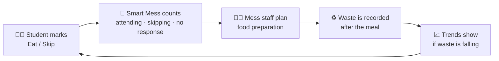

# Smart-Mess
<div align="center">

# 🌱 Smart Mess

### *Eat Smart. Waste Less.*

**A hostel mess platform where students say in advance which meals they'll eat or skip, so the kitchen cooks for the people who actually show up.**


[🚀 Live Demo](#-live-demo) · [✨ Features](#-features) · [🧭 How It Works](#-how-it-works) · [🛠️ Run Locally](#️-run-locally) · [🗺️ Roadmap](#️-roadmap)

</div>

---

## 🍽️ The Problem

Hostel messes often cook for **every registered student**, not for the students who will actually eat. Classes, events, travel, weekend outings, health reasons and eating outside all lead to skipped meals, and the surplus food is wasted.

## 💡 The Idea

> **Ask first. Cook second.**

Students mark each meal as **attending** or **skipping** before a deadline. The mess team sees expected attendance per meal and can plan preparation around real numbers.

One rule matters: **"not responded" is never treated as "skipping".** The dashboard always shows attending, skipping and no response as three separate numbers.

---

## 🧭 How It Works



---

## ✨ Features

### 🎓 For Students
| | Feature | What it does |
|---|---|---|
| ⚡ | **One-tap meal choice** | "What are you eating today?" is the first thing on the dashboard: **✓ I'll Eat** or **× I'll Skip** |
| 🔒 | **Deadline enforcement** | Change your mind freely until the deadline; after that the meal locks |
| 📅 | **Upcoming meals** | Today and the next days, with your status on each card |
| 🕘 | **My History** | Every past meal and what you chose |
| 🌱 | **Impact page** | Meals planned, meals skipped, and clearly-labelled *estimates* of portions saved |
| 🔔 | **Notifications** | Welcome message and a note when your skip helps reduce preparation |
| 👤 | **Profile** | Edit name, hostel block and room |

### 🧑‍🍳 For Mess Admins
| | Feature | What it does |
|---|---|---|
| 📊 | **Mess Overview** | *"How many people are actually eating today?"* answered first |
| 🍳 | **Meal management** | Create, edit and delete meals, menus, times and selection deadlines |
| 👥 | **Attendance view** | Pick a date and meal; see expected, skipping and no-response counts, with an anonymised student table and filter |
| ♻️ | **Food waste tracking** | Enter prepared and served portions; wasted portions and **waste % = wasted ÷ prepared × 100** are calculated automatically |
| 📈 | **Analytics** | Weekly waste line chart, attendance bars, participation donut |
| ✨ | **Smart Prediction** | Clearly labelled **Coming soon**; no model is running today |
| ⚙️ | **Settings** | Light/dark theme and a one-click reset of the demo data |

### 🌐 Public
- Landing page with the problem, how-it-works steps, features and a **live impact section** read from the app's own data
- Sign up, log in, log out and password reset
- Role-based route protection: students can't open admin pages, and admins aren't treated as students

---

## 🔑 Demo Accounts

| Role | Email | Password |
|---|---|---|
| 🎓 Student | `student@smartmess.demo` | `demo1234` |
| 🧑‍🍳 Admin | `admin@smartmess.demo` | `demo1234` |

> ⚠️ These are **development-only demo credentials** that live in local demo data. Never use them (or this auth approach) in production.

---

## 🎨 Design System

Soft cream-white surfaces with fresh greens, and one warm accent reserved for warnings and food waste.

| Swatch | Hex | Used for |
|---|---|---|
| ⬜ | `#FFFFFF` | Page and card background |
| 🟩 | `#A0C878` | Status, primary buttons, active navigation, charts |
| 🟫 | `#27311d` | Text |
| 🟧 | `#E8A07C` | Skipped meals and food waste (warning) |

**Principles:** rounded cards, subtle borders, generous spacing, short animations, and status shown with **text and icons, not colour alone** (✓ attending / × skipped). Keyboard focus is visible, charts have text labels, and `prefers-reduced-motion` is respected.

---

## 🛠️ Run Locally

No install, no build, no server.

```bash
# 1. Clone
git clone https://github.com/<your-username>/smart-mess.git
cd smart-mess

# 2. Open the file in any modern browser
open smart-mess.html        # macOS
start smart-mess.html       # Windows
xdg-open smart-mess.html    # Linux
```

Or just **double-click `smart-mess.html`**.

## 🚀 Live Demo

Host the single file anywhere static:

- **Netlify Drop:** drag and drop `smart-mess.html`
- **GitHub Pages:** *Settings → Pages → deploy from branch*, and rename the file to `index.html`
- **Vercel:** import the repo as a static site

> 🔗 Live link: `https://<your-site-url>`

---

## 🧱 Project Structure

```
smart-mess/
├── smart-mess.html   # the whole app: CSS + HTML shell + JavaScript
└── README.md
```

Inside `smart-mess.html`:

| Section | Responsibility |
|---|---|
| `<style>` | Design tokens (CSS variables), layout, components, responsive rules |
| Data layer | Seed/demo data, `localStorage` persistence, `cnt()` demand calculation |
| Charts | Tiny dependency-free SVG bar, line and donut helpers |
| Views | `vSDash`, `vAMeals`, `vAAtt`, `vAWaste` … one render function per page |
| Router | Hash routes (`#s-dash`, `#a-dash` …) with role guards |

**Demand calculation:** `Expected attendance = number of students marked "attending"`. It lives in one function (`cnt`) so a prediction model can later replace or supplement it.

---

## ⚠️ Honest Limitations

This is a **demo-ready prototype**, and these limits are deliberate to keep it honest:

- 💾 **Data lives in each visitor's browser** (`localStorage`). Two people on different devices do **not** share meal responses, and the admin only sees data from the same browser.
- 🔐 **Auth is simulated.** Passwords are stored unhashed locally. Fine for a demo, **not** for production.
- 🧪 **Demo data is labelled.** Counts include a seeded **200-student demo cohort**, clearly marked as demo data. Waste is measured in **portions**, not kilograms.
- 🤖 **No AI yet.** "Smart Prediction" is a labelled future feature; the range shown is an illustrative simulation, not a model.
- ✅ **Not yet tested** on a full device matrix or with automated tests.

---

## 🗺️ Roadmap

- [x] Student meal selection with deadlines
- [x] Admin meal CRUD, attendance and waste tracking
- [x] Analytics charts and responsive layout
- [ ] 🗄️ **Supabase backend:** real auth, PostgreSQL, Row Level Security, realtime updates
- [ ] 🔐 Hashed passwords and email-based password reset
- [ ] ⚛️ Migrate to React + Vite + Tailwind with a typed component structure
- [ ] 🔔 Push/email reminders before deadlines
- [ ] 🤖 **Smart Prediction:** forecast attendance from history, weekday, holidays, exams and weather
- [ ] 📤 CSV/PDF reports for mess committees
- [ ] 🧪 Automated tests and accessibility audit

### 🗄️ Planned database schema

```
profiles        id · name · email · student_id · hostel · room_number · role · created_at
meals           id · meal_type · date · menu · selection_deadline · created_at
meal_responses  id · student_id · meal_id · status · updated_at   (unique: student_id + meal_id)
food_waste      id · meal_id · prepared · served · wasted · recorded_at
notifications   id · user_id · title · message · read · created_at
```

`status` ∈ `attending | skipping | not_responded`

---

## 🤝 Contributing

Ideas and pull requests are welcome. Open an issue first for larger changes.

## 📄 License

Choose a license for your repository (for example MIT) and add a `LICENSE` file.

---

<div align="center">

**Smart Mess** · *Eat Smart. Waste Less.*

Built for a more sustainable campus 🌱

</div>
